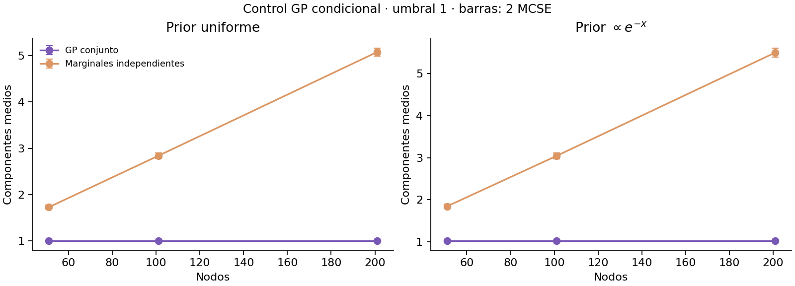

# FractalGo
### Diagnóstico topológico · software reproducible

[English](README_EN.md) · **Castellano** · [Método](docs/METHOD_ES.md) · [Procedencia](docs/PROVENANCE_ES.md)

**La misma distribución de valores puede esconder una conectividad distinta.** FractalGo conserva el grafo, los identificadores y las dependencias para examinar esa diferencia. Es una herramienta visual de diagnóstico local: no estima una dimensión fractal ni sustituye la validación del experimento.



## Empezar sin GitHub

Descargá el ZIP del repositorio y extraelo. Abrí `ABRIR_FRACTALGO.bat` en Windows, `ABRIR_FRACTALGO.command` en macOS o ejecutá `bash ABRIR_FRACTALGO.bash` en Linux. Requiere Python 3.13; la primera instalación descarga dependencias. El navegador abre la interfaz local. Para reproducir cálculos y figuras usá `REPRODUCIR_TODO`; para redibujar resultados ya calculados, `REGENERAR_FIGURAS`. En macOS puede ser necesario autorizar el script descargado o ejecutarlo desde Terminal.

[Cuaderno autónomo castellano](FRACTALGO_ES.ipynb) · [Cuaderno autónomo inglés](FRACTALGO_EN.ipynb). Colab permite usarlos desde iPad/iPhone: no se anuncia un ejecutable iOS nativo.

## Qué contiene esta versión

- Núcleo para grafos finitos y excursiones posteriores relativas al prior.
- Testigo exacto de 80 nodos: iguales resúmenes escalares, 1 frente a 40 componentes.
- Control GP: 51/101/201 nodos, dos priors, tres umbrales, 1024 realizaciones conjuntas y marginales.
- Cassini: 1696 épocas reconstruidas, 20 pasadas, 512 réplicas por modelo. Diagnóstico condicional y exploratorio.
- Interfaz interactiva bilingüe, entradas verificables, registros de ejecución, figuras regenerables y lanzadores para tres sistemas.

```bash
python -m pip install -r requirements.txt
python run.py all
python run.py ui
```

Los resultados se regeneran desde los insumos incluidos; las figuras leen esos resultados. La reconstrucción instrumental de Cassini es una entrada heredada, no telemetría primaria reducida aquí. La comparación de algoritmos no crea independencia observacional. [Contrato completo](research/fractalgo/CONTRACT_ES.md).

## Estado y cita

Versión 0.1.0. DOI de esta versión: [10.5281/zenodo.24383318](https://doi.org/10.5281/zenodo.24383318). `CITATION.cff` y `.zenodo.json` están preparados; el registro identifica esta versión del software. [Relación con GRAVITAS](docs/PROVENANCE_ES.md). Manuscritos y evaluaciones privadas quedan fuera de este repositorio.

[Licencias y procedencia](LICENSES.md) · [Contribuir](CONTRIBUTING_ES.md) · [Resultados y límites](docs/RESULTS_ES.md)

[Abrir en Colab](https://colab.research.google.com/github/FacundoFirmenich/fractal-go/blob/Ulalito%27s-Island/FRACTALGO_ES.ipynb)

FractalGo v0.1.0: [10.5281/zenodo.24383318](https://doi.org/10.5281/zenodo.24383318) · Todas las versiones: [10.5281/zenodo.24383317](https://doi.org/10.5281/zenodo.24383317).
