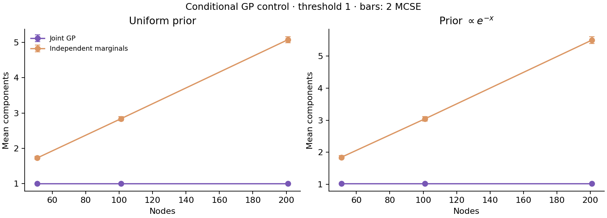

# FractalGo
### Topological diagnostics · reproducible software

**English** · [Castellano](README_ES.md) · [Method](docs/METHOD_EN.md) · [Provenance](docs/PROVENANCE_EN.md)

**The same distribution of values can hide different connectivity.** FractalGo retains the graph, identifiers and dependencies to examine that difference. It is a visual tool for local diagnosis: it does not estimate a fractal dimension or replace experimental validation.



## Start without GitHub

Download the repository ZIP and extract it. Open `OPEN_FRACTALGO.bat` on Windows, `OPEN_FRACTALGO.command` on macOS, or run `bash OPEN_FRACTALGO.bash` on Linux. Python 3.13 is required; the first installation downloads dependencies. Your browser opens the local interface. Use `REPRODUCE_ALL` to regenerate calculations and figures; use `REGENERATE_FIGURES` to redraw previously calculated results. On macOS you may need to authorize the downloaded script or run it from Terminal.

[Standalone English notebook](FRACTALGO_EN.ipynb) · [Standalone Spanish notebook](FRACTALGO_ES.ipynb). Colab supports iPad/iPhone use: no native iOS executable is claimed.

## Included in this version

- Finite-graph core and prior-relative posterior excursions.
- Exact 80-node witness: identical scalar summaries, 1 versus 40 components.
- GP control: 51/101/201 nodes, two priors, three thresholds, 1024 joint and marginal realizations.
- Cassini: 1696 reconstructed epochs, 20 passes, 512 replicates per model. Conditional, exploratory diagnosis.
- Bilingual interactive interface, inspectable inputs, execution records, regenerable figures and launchers for three systems.

```bash
python -m pip install -r requirements.txt
python run.py all
python run.py ui
```

Results are regenerated from bundled inputs; figures read those results. The Cassini instrumental reconstruction is an inherited input, not primary telemetry reduced here. Agreement between algorithms does not create observational independence. [Full contract](research/fractalgo/CONTRACT_EN.md).

## Status and citation

Version 0.1.0. Version DOI: [10.5281/zenodo.24383318](https://doi.org/10.5281/zenodo.24383318). `CITATION.cff` and `.zenodo.json` are prepared; the record identifies this software version. [Relationship to GRAVITAS](docs/PROVENANCE_EN.md). Manuscripts and private assessments remain outside this repository.

[Rights and provenance](LICENSES.md) · [Contributing](CONTRIBUTING_EN.md) · [Results and limitations](docs/RESULTS_EN.md)

[Open in Colab](https://colab.research.google.com/github/FacundoFirmenich/fractal-go/blob/Ulalito%27s-Island/FRACTALGO_EN.ipynb)

FractalGo v0.1.0: [10.5281/zenodo.24383318](https://doi.org/10.5281/zenodo.24383318) · All versions: [10.5281/zenodo.24383317](https://doi.org/10.5281/zenodo.24383317).
